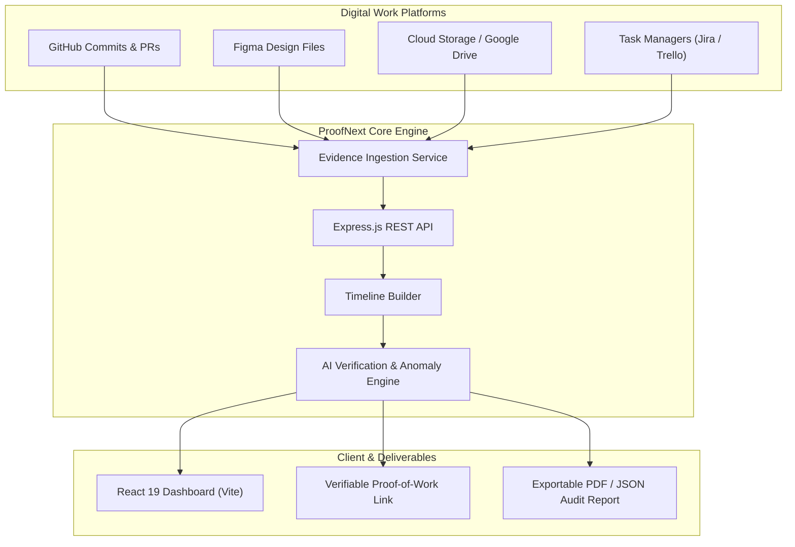

# ProofNext 🛡️
> **AI-Powered SaaS Platform for Verifiable Digital Work Evidence & Deliverable Auditing**

[](LICENSE)
[](https://nodejs.org/)
[](https://react.dev/)
[](https://vite.dev/)
[](https://expressjs.com/)
[](CONTRIBUTING.md)

---

## 📖 Table of Contents
- [Overview](#-overview)
- [Problem & Solution](#-problem--solution)
- [Key Features](#-key-features)
- [Architecture & Workflow](#-architecture--workflow)
- [Tech Stack](#-tech-stack)
- [Repository Structure](#-repository-structure)
- [Prerequisites](#-prerequisites)
- [Getting Started](#-getting-started)
- [Environment Configuration](#-environment-configuration)
- [Roadmap](#-roadmap)
- [Contributing](#-contributing)
- [License](#-license)

---

## 🌟 Overview

**ProofNext** (ProofNest) is an AI-powered SaaS platform engineered to verify and document digital work through automated evidence aggregation and intelligent deliverable auditing. 

In distributed, remote, and freelance environments, ProofNext acts as an objective, tamper-evident record of progress—bridging the trust gap between individual contributors, agencies, clients, and hiring managers.

---

## 📌 Problem & Solution

### The Challenge
In modern remote work and freelance contracts, organizations routinely face friction verifying whether promised work was completed with genuine effort:
- **Opaque Self-Reporting**: Manual progress summaries and screenshots are subjective, time-consuming to review, and easy to manipulate.
- **Milestone & Payment Disputes**: Clients and contractors frequently disagree on deliverables due to lack of verifiable timeline records.
- **Invasive Surveillance Backlash**: Traditional time-tracking software (keyloggers, webcam snapshots) harms trust and violates privacy without guaranteeing deliverable quality.

### The ProofNext Solution
ProofNext replaces invasive surveillance with **evidence-backed verification**:
1. **Aggregates Activity Logs**: Automatically syncs verifiable digital footprints across GitHub, Figma, Google Drive, and task managers.
2. **Assembles Chronological Timelines**: Creates an indisputable, timestamped evidence trail of milestones, commits, and file changes.
3. **AI Deliverable Auditing**: Uses Large Language Models (LLMs) to compare client task criteria against actual submitted output.
4. **Calculates Work Verification Score (WVS)**: Generates an objective integrity score (0–100%) and exportable audit certificates.

---

## 🚀 Key Features

| Feature | Description |
| :--- | :--- |
| **Multi-Source Evidence Aggregation** | Ingests activities from GitHub (commits, PRs), design tools (Figma versions), cloud storage, and task management boards. |
| **Chronological Audit Timeline** | Tamper-evident record of iterations and timestamped deliverables, organized by milestone. |
| **AI Deliverable Auditing** | Automatically compares declared scopes against real artifacts, detecting shallow submissions or missing deliverables. |
| **Work Verification Score (WVS)** | Objective confidence score based on commit regularity, artifact completeness, and task alignment. |
| **Contributor Showcase Portal** | Freelancers and team members can share cryptographically verifiable proof-of-work links with clients. |
| **Manager & Agency Dashboard** | Review team progress, inspect granular evidence trails, and export branded PDF/JSON compliance reports. |
| **Multi-Tenant SaaS & RBAC** | Organization-level workspaces with Role-Based Access Control (Admins, Reviewers, Contributors). |

---

## 🏗️ Architecture & Workflow



---

## 🛠️ Tech Stack

### Frontend
- **Framework**: [React 19](https://react.dev/)
- **Build Tool**: [Vite 8](https://vite.dev/)
- **Icons**: [Lucide React](https://lucide.dev/)
- **Linter**: [Oxlint](https://oxc.rs/)

### Backend
- **Runtime**: [Node.js](https://nodejs.org/) (v18+)
- **Server Framework**: [Express 5](https://expressjs.com/)
- **Middleware & Utilities**: `cors`, `dotenv`, `uuid`

### AI & Data Processing
- **AI Verification Pipeline**: LLM integrations (Gemini / OpenAI API) for deliverable benchmarking and anomaly detection
- **Integrations**: GitHub REST / GraphQL API, Webhook endpoints

---

## 📁 Repository Structure

```text
ProofNext/
├── .env.example            # Environment variables template
├── .gitignore              # Root git ignore rules
├── package.json            # Root backend dependencies & scripts
├── package-lock.json       # Root dependency lockfile
├── README.md               # Main project documentation
│
└── client/                 # Frontend Single Page Application (React + Vite)
    ├── .gitignore          # Client-specific git ignore rules
    ├── .oxlintrc.json      # Oxlint configuration
    ├── index.html          # HTML entry point
    ├── package.json        # Frontend dependencies & build scripts
    ├── README.md           # Client-specific documentation
    ├── vite.config.js      # Vite configuration
    ├── public/             # Static public assets (icons, favicon)
    └── src/                # React source code
        ├── App.css         # Application component styles
        ├── App.jsx         # Root React component & views
        ├── index.css       # Global design tokens and reset styles
        ├── main.jsx        # Application DOM bootstrap entry
        └── assets/         # Images, illustrations, and SVG logos
```

---

## 📋 Prerequisites

Before running the project locally, ensure you have:
- **Node.js**: v18.0.0 or later (v20+ LTS recommended) — [Download Node.js](https://nodejs.org/)
- **npm**: v9.0.0 or later (packaged with Node.js)
- **Git**: [Download Git](https://git-scm.com/)

---

## 📦 Getting Started

### 1. Clone the Repository
```bash
git clone https://github.com/Athul3588krishna/ProofNext.git
cd ProofNext
```

### 2. Configure Environment Variables
Copy the sample environment file and fill in the necessary keys:
```bash
cp .env.example .env
```

### 3. Install Root & Backend Dependencies
```bash
npm install
```

### 4. Install & Run Frontend Client
Open a terminal and navigate to the `client` directory:
```bash
cd client
npm install
npm run dev
```
The client development server will start at:
👉 **`http://localhost:5173`** (or the port indicated in your console)

---

## ⚙️ Environment Configuration

Refer to [`.env.example`](.env.example) for all available options:

| Variable | Description | Default / Example |
| :--- | :--- | :--- |
| `PORT` | Port for the backend server | `5000` |
| `NODE_ENV` | Environment mode (`development` or `production`) | `development` |
| `CLIENT_URL` | URL of the frontend client for CORS policy | `http://localhost:5173` |
| `AI_PROVIDER` | AI provider for verification pipeline (`gemini` / `openai`) | `gemini` |
| `GEMINI_API_KEY` | API Key for Google Gemini LLM engine | `your_gemini_api_key_here` |
| `GITHUB_ACCESS_TOKEN` | Personal Access Token for GitHub API ingestion | `your_github_token_here` |
| `JWT_SECRET` | Secret token for authentication & signing certificates | `your_secret_key` |

---

## 🧭 Roadmap

- [x] **Phase 1: Project Scaffolding**
  - [x] Vite + React 19 client setup
  - [x] Root project configuration and dependencies
  - [x] Repository documentation and environment templates
- [ ] **Phase 2: Backend API & Integrations**
  - [ ] Express server routing and authentication middleware
  - [ ] GitHub REST API integration for commit and PR log fetching
  - [ ] Webhook receiver for real-time activity events
- [ ] **Phase 3: Evidence Timeline & Verification Engine**
  - [ ] Chronological activity stream generator
  - [ ] LLM-assisted deliverable validation against milestone specifications
  - [ ] Work Verification Score (WVS) algorithm implementation
- [ ] **Phase 4: Contributor & Client Dashboards**
  - [ ] Interactive timeline visualization in React
  - [ ] Public shareable proof-of-work link generator
  - [ ] Automated PDF & JSON audit report export
- [ ] **Phase 5: Enterprise & Multi-Tenancy**
  - [ ] Organization workspaces & Role-Based Access Control (RBAC)
  - [ ] Slack & Discord notification webhooks

---

## 🤝 Contributing

Contributions are always welcome!

1. **Fork** the repository
2. **Create** your feature branch:
   ```bash
   git checkout -b feature/amazing-feature
   ```
3. **Commit** your changes:
   ```bash
   git commit -m "feat: add amazing feature"
   ```
4. **Push** to the branch:
   ```bash
   git push origin feature/amazing-feature
   ```
5. **Open** a Pull Request

---

## 📄 License

This project is licensed under the **ISC License**. See the [package.json](package.json) file for details.
